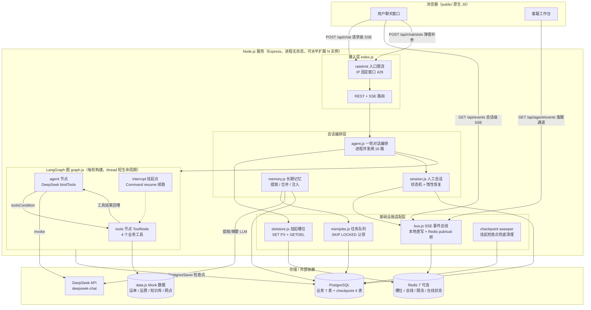
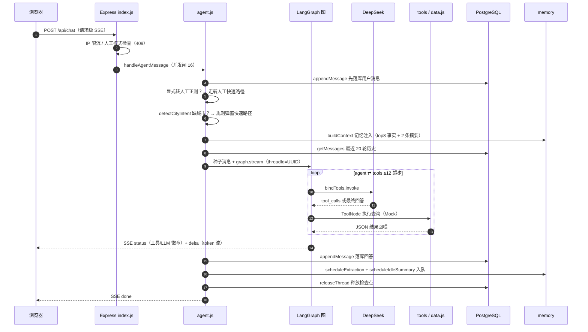
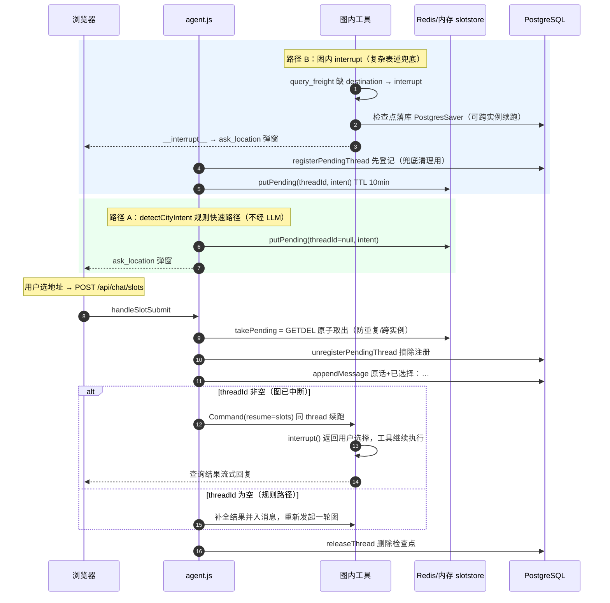
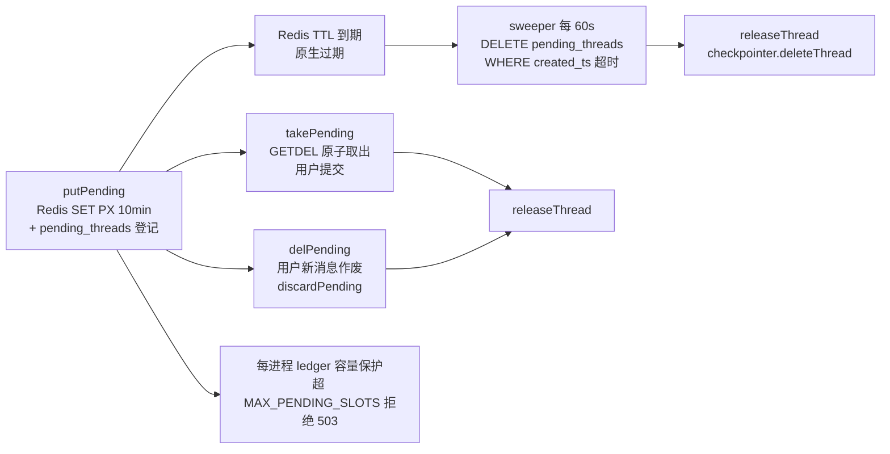
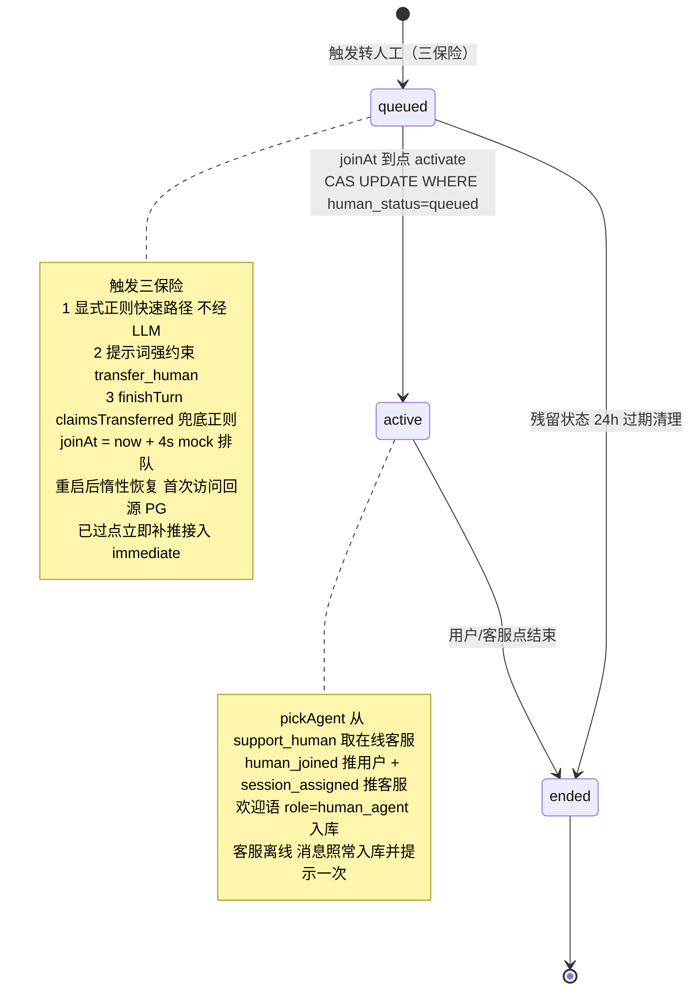
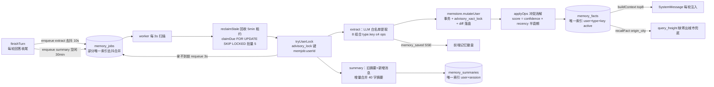
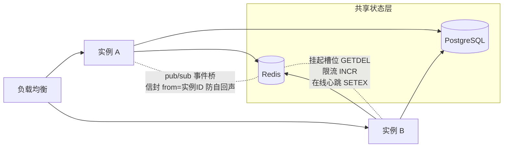

# 物流智能客服 Demo — 架构说明

> 项目：`project/RAG-ai/logistics-cs-demo`
> 技术栈：Node.js 18+ 纯 JavaScript · Express · LangGraph.js 0.4.10（StateGraph agent⇄tools）· LangChain + DeepSeek(deepseek-chat) · PostgreSQL · Redis(可选) · 双通道 SSE · 原生前端

---

## 1. 总体架构图

分层职责：

| 层 | 文件 | 职责 |
|---|---|---|
| 前端 | `public/` | 用户聊天窗 + 客服工作台，EventSource 双通道 |
| 接入层 | `server/index.js` | 路由、入口限流、SSE 头、优雅退出（SIGTERM 停 worker/释放连接池） |
| 会话编排 | `server/agent.js` | 意图快速路径、槽位补全调度、并发闸、收口落库 |
| 人工会话 | `server/session.js` | 排队→接入→结束状态机、重启惰性恢复、CAS 抢占接入 |
| Agent 图 | `server/graph.js` | LangGraph 编排、interrupt 挂起、检查点注册表 + sweeper |
| 工具/数据 | `server/tools.js`、`server/data.js` | 4 个业务工具 + Mock 数据源（运单/运费/知识库/网点） |
| 长期记忆 | `server/memory.js`、`memstore.js`、`memjobs.js` | L2 语义事实 + L1 会话摘要，提取/冲突消解/注入/持久化队列 |
| 基础设施 | `bus.js`、`slotstore.js`、`ratelimit.js`、`redis.js` | 事件总线、挂起槽位、限流、Redis 接入与降级 |
| 辅助 | `scripts/eval.js` 等 | 六阶段自动化评测、JSON→PG 记忆迁移 |

---

## 2. 数据与状态流转

### 2.1 一轮智能对话（主链路）

数据走向：**用户消息 → PG 落库 →（记忆块 + 历史 20 轮）拼装成图种子 → 图状态存 PG 检查点 → 回答流式回前端 → 回答再落库**。对话历史以 PostgreSQL 为准，每轮重新注入图状态，图内 `messages` 只保留单轮执行上下文。

### 2.2 缺参补全：interrupt 挂起与续跑（双路径）

两条路径统一由 `POST /api/chat/slots` 提交恢复，区分点是挂起登记里的 `threadId` 是否为空：

挂起状态的完整生命周期（含清理路径）：

### 2.3 转人工：会话状态机

`chat_sessions.human_status` 的流转（状态每次变更写 PG，内存 Map 仅作 2s TTL 缓存防跨实例脏读）：

人工模式期间 `/api/chat` 返回 409 拒绝智能回复；会话结束后触发 `summarizeSession`（取消空闲摘要任务、立即摘要一次）。

### 2.4 长期记忆管线（L2 事实 + L1 摘要）

关键状态/规则：

| 环节 | 规则 |
|---|---|
| 去抖合并 | 同一 `dedupe_key`（如 `extract:user:session`）只允许一条 pending，窗口内新对话 `payload || EXCLUDED.payload` 合并并刷新 `run_at` |
| 冲突消解 | 显式声明（explicit）无条件覆盖；推断冲突时新证据 score < 旧 score − 0.2 → 仅降置信 0.2；覆盖前旧值压入 `history`（≤5 条） |
| habit 类 | 单值覆盖改为最近 3 个不同值的滑动窗口 |
| 淘汰 | 读取时惰性 sweep（过期 / confidence<0.3 → archived）；容量 100 条事实 / 20 条摘要按 updated_at 淘汰；context 类 14 天 TTL |
| 命中强化 | `bumpFact` 原子 SQL：hits+1、confidence 微升，前端发 `memory_used` 事件 |
| 失败处理 | 指数退避 5s→10s，最多 3 次后置 dead（死信留表排查）；running 超 5 分钟租约视为进程死亡被回收 |

### 2.5 多实例部署下的状态归属

各状态对象的归属与跨实例语义：

| 状态对象 | 存哪 | 跨实例/恢复语义 |
|---|---|---|
| 图执行状态（messages） | PG `checkpoints*`（PostgresSaver） | A 实例挂起的弹窗，B 实例可用同 thread_id 续跑；重启不丢 |
| 挂起弹窗槽位 | Redis `cs:pending:*`（未配 Redis 则进程内存） | TTL 10min 原生过期；GETDEL 保证提交只被消费一次 |
| 挂起检查点登记 | PG `pending_threads` | Redis 键过期后由 sweeper 兜底删除检查点，防泄漏 |
| 人工会话状态 | PG `chat_sessions.human_*` | 内存缓存 2s TTL 回源；queued/active 重启后惰性恢复 |
| 对话消息 | PG `chat_messages` | 重启/刷新后 `/api/history` 完整恢复 |
| 长期记忆 | PG `memory_facts` / `memory_summaries` | 跨会话、跨实例生效 |
| 记忆任务 | PG `memory_jobs` | 重启不丢；SKIP LOCKED 多实例不重复消费 |
| SSE 连接 | 进程本地 Map（连接只能写在本进程） | 事件发布双写：本地直写 + Redis PUBLISH 到持有连接的实例 |
| 客服在线状态 | Redis `cs:presence:agent:*` | SETEX 20s / 10s 心跳；最后连接断开即 DEL |

---

## 3. 表设计

PostgreSQL 共两类：**业务 7 表**（`db.js initDb()` 幂等建表）+ **LangGraph checkpoint 4 表**（`PostgresSaver.setup()` 自动建）。

```mermaid
erDiagram
    support_human ||--o{ chat_sessions : "human_agent_id 接入"
    chat_sessions ||--o{ chat_messages : "session_id CASCADE"
    chat_sessions ||--o{ pending_threads : "session_id 挂起登记"

    chat_sessions {
        text session_id PK "前端生成的会话ID"
        text human_status "queued active ended"
        int human_queue_position "排队位置"
        int human_agent_id FK "接入的客服"
        bigint human_join_at "预约接入时间 毫秒"
        bigint human_updated_at "人工状态变更时间"
        timestamptz created_at "审计"
        timestamptz updated_at "审计"
    }
    chat_messages {
        bigint id PK "BIGSERIAL 自增"
        text session_id FK "会话"
        text role "user assistant human_agent system"
        text name "客服姓名"
        text content "消息内容"
        bigint ts "毫秒时间戳"
    }
    support_human {
        int id PK
        text name "姓名"
        text code UK "工号 唯一"
        text status "online offline"
    }
    memory_facts {
        text id PK "f_xxx"
        text user_id "userId 命名空间"
        text type "attribute preference habit context"
        text key "白名单8组合"
        jsonb value "短语或数组"
        real confidence "0-1"
        text source "explicit inferred"
        text evidence "用户原话片段"
        int hits "命中次数"
        text status "active superseded archived"
        jsonb history "旧值归档5条"
        bigint updated_at "毫秒"
        bigint expires_at "context 14天TTL"
    }
    memory_summaries {
        text id PK
        text user_id
        text session_id "会话摘要 一会话一条"
        text summary "40字以内"
        bigint until_ts "覆盖到的最后消息时间"
        bigint ts
    }
    memory_jobs {
        bigint id PK "BIGSERIAL"
        text kind "extract summary"
        text dedupe_key "extract:uid:sid 去抖键"
        text user_id
        text session_id
        jsonb payload "待提取对话轮次"
        text status "pending running done dead"
        bigint run_at "执行时间 去抖/退避"
        int attempts "重试次数 上限3"
        text last_error "死信排查"
    }
    pending_threads {
        text thread_id PK "LangGraph thread"
        text session_id
        timestamptz created_ts "sweeper 扫描依据"
    }
```

设计要点：

| 表 | 设计意图 |
|---|---|
| `chat_sessions` | 人工会话状态**以 PG 为准**（可跨实例、可重启恢复），内存 Map 只是 2s TTL 缓存；`activateHumanQueued` 用 `UPDATE … WHERE human_status='queued'` 做 CAS，保证多实例只有一个接入成功 |
| `chat_messages` | 四种 role 统一存储（user / assistant / human_agent / system），`(session_id, id)` 索引支撑历史查询；append 时滚动截断保留最近 N 条 |
| `memory_facts` | **部分唯一索引 `(user_id, type, key) WHERE status='active'`**：同一用户同一键最多一条 active 事实，冲突消解的唯一性由数据库兜底；`history` JSONB 保留旧值可回溯；软删除（superseded/archived）可审计 |
| `memory_summaries` | `(user_id, session_id)` 唯一：一会话一条摘要，`until_ts` 作为幂等基准（会话无新消息则跳过重摘） |
| `memory_jobs` | **部分唯一索引 `(dedupe_key) WHERE status='pending'`**：去抖合并的关键——窗口内多轮对话合并 payload、推迟 run_at，只跑一次 LLM；`(status, run_at)` 索引支撑 worker 扫描；dead 死信留表排查 |
| `pending_threads` | Redis 挂起键过期后“没人记得还有检查点要删”——登记表保证**先登记后写 Redis**，任何失败路径都能被 sweeper `DELETE … RETURNING` 兜底释放检查点 |
| checkpoint 4 表 | LangGraph `checkpoints / checkpoint_blobs / checkpoint_writes / checkpoint_migrations`，与业务共用同一个 pg 连接池；thread 是短生命周期状态：正常收尾/作废即 `deleteThread`，仅挂起期间驻留 |

时间戳约定：业务字段（`ts / join_at / run_at` 等）用**毫秒 BIGINT** 与上层 `Date.now()` 对齐；`created_at` 等用 TIMESTAMPTZ 仅作库内审计。

---

## 4. 中间件清单：用了什么、解决什么问题

| 中间件 / 组件 | 用在哪 | 解决的问题 | 关键机制 |
|---|---|---|---|
| **LangGraph.js 0.4.10** | `graph.js` | 把手写 ReAct 循环改成声明式编排；缺参时不硬编码追问流程 | `StateGraph` agent⇄tools + `ToolNode` + `toolsCondition`；`interrupt()` 挂起整图 + `Command(resume)` 断点续跑（补的参数经 interrupt 返回值注入）；`recursionLimit=12` 防失控，超限优雅收口 |
| **PostgreSQL（pg 连接池）** | `db.js` 等 | 全部业务持久化的单一事实源 | 池 max=10；业务表与 checkpoint 表共用池 |
| **PostgresSaver（langgraph-checkpoint-postgres）** | `graph.js` | 图状态不能只在内存：多实例要共享、重启要不丢、Node 内存不能随挂起数增长 | 检查点落 PG；A 实例 interrupt 挂起 → B 实例同 thread 续跑；thread 短生命周期及时 `deleteThread` |
| **Redis（ioredis，可选）** | `redis.js` | 多实例水平扩展时把四类“进程内状态”外置，进程变无状态；未配置时各模块自动降级进程内存（单机演示模式） | 懒创建单例 + pub/sub 专用 duplicate 连接 |
| ├ 挂起槽位 `slotstore.js` | `cs:pending:*` | 弹窗挂起不能进程私有（A 挂起 B 提交）、重启不丢、超时要自动过期、重复提交要幂等 | `SET key PX ttl`（TTL 原生）+ `GETDEL` 原子取出；每进程 ledger 容量上限 10000 拒绝新挂起（503） |
| ├ SSE 事件桥 `bus.js` | `cs:bus:session:{id}` / `cs:bus:agent:{id}` | “发布事件的进程”与“持有 SSE 连接的进程”可能不同，跨实例事件会丢 | 推送双写：本地直写（零延迟）+ Redis PUBLISH；信封带实例 ID 防自回声重复投递；按需 subscribe/unsubscribe |
| ├ 入口限流 `ratelimit.js` | `cs:rl:{route}:{ip}` | 突发流量打爆上游 LLM；限流窗口要跨实例共享 | 固定窗口 `INCR + PEXPIRE`，超限 429；限流器自身故障时**放行**（可用性优先） |
| ├ 客服在线状态 `bus.js` | `cs:presence:agent:{id}` | 多实例下“是否在线”不能只看本进程连接 | `SETEX` 20s TTL / 10s 心跳刷新；最后连接断开立即 DEL |
| **PG 任务队列 `memjobs.js`** | `memory_jobs` | 记忆提取异步化：不能阻塞回答链路，重启不丢任务，多实例不重复消费，失败可重试 | `FOR UPDATE SKIP LOCKED` 事务内认领；指数退避 3 次后 dead 死信；5 分钟租约回收 running 卡死任务；worker 3s 扫描、批量 5、单飞防堆积 |
| **PG advisory lock** | `memstore.js` / `memjobs.js` | 同一用户的记忆“读-改-写”并发会互相覆盖（多实例/多请求） | `mutateUser`：事务 + `pg_advisory_xact_lock(hash(userId))` 串行化 + **diff 落盘**（按签名比较只写变更行）；worker 侧 `pg_try_advisory_lock('memjob:'+userId)`（独立命名空间防自锁），拿不到锁 3s 后重试 |
| **pending_threads + sweeper** | `graph.js` | 用户放弃弹窗后，Redis 键过期但 PG 检查点残留 → 泄漏累积 | 挂起登记“先写 PG 再写 Redis”；sweeper 每 60s `DELETE … WHERE created_ts < TTL RETURNING` → `deleteThread` |
| **两级过载保护** | `ratelimit.js` + `agent.js` | 入口限流之外，进程内还要防突发并发压垮 LLM 上游 | 入口 IP 固定窗口（跨实例）+ 每进程 `MAX_CONCURRENT_TURNS=16` 并发闸（含转人工路径），超限快速 429 |
| **docker compose Redis** | `docker-compose.yml` | 本机 6379 被占用，一键起独立 Redis | `redis:7-alpine` 映射 127.0.0.1:6390，不持久化 + allkeys-lru 256mb（demo 数据重启即清） |

一句话总结：**LangGraph 管“怎么执行”（编排 + 挂起续跑），PostgreSQL 管“状态真相”（业务数据、图检查点、任务队列、分布式锁），Redis 管“跨实例协调”（槽位、事件、限流、在线状态，缺席即降级内存）**。
